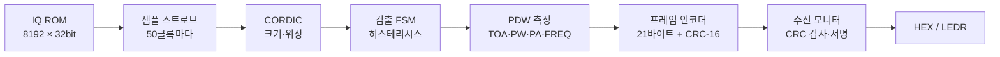

# rtl-pdw

**펄스 검출·PDW 생성기 + 텔레메트리 프레임 인코더 (순수 RTL, Cyclone V)**

단일 채널 합성 레이더 IQ 신호에서 펄스를 검출해 PDW(Pulse Descriptor Word: TOA, PW, PA, FREQ, FLAGS)를 만들고, CRC-16이 붙은 21바이트 텔레메트리 프레임으로 내보내는 회로입니다. IP 코어 없이 Verilog로 작성했고, DE10-Standard 보드에서 동작을 확인했습니다.

| 항목 | 결과 |
|---|---|
| 검출 | 정답 191개 중 191개 검출, 오검출 0 |
| 프레임 | CRC 통과 100%, PDW 유실 0 |
| RTL 검증 | 비트 단위 Python 모델과 모든 필드 차이 0 |
| 자원 | ALM 467 / 41,910 (1.1%), M10K 32, DSP 0 |
| 타이밍 | Fmax 130.21MHz (동작 클록 50MHz) |
| 보드 | 시뮬레이션과 같은 프레임 수·스트림 서명, Signal Tap으로 첫 프레임 21바이트 확인 |

PDW는 ES(전자전 지원) 수신기의 기본 출력입니다. 수신 신호를 펄스 단위의 숫자 기록으로 바꿔야 위협 식별과 분류를 할 수 있습니다. 이 프로젝트는 그 처리부를 작은 규모로 구현하고, 결과를 지상으로 내려보내는 텔레메트리 형식까지 연결했습니다.

---

## 1. 구조



샘플마다 CORDIC으로 크기와 위상을 구하고, 검출 FSM이 펄스의 시작과 끝을 판정합니다. 펄스가 끝나면 PDW 한 건을 확정해 프레임 인코더로 넘기고, 인코더는 valid/ready 바이트 스트림으로 내보냅니다. 보드에서는 수신 모니터가 프레임마다 CRC를 다시 계산해 결과를 HEX와 LED로 보여 줍니다.

### 주요 설계 값

| 항목 | 값 |
|---|---|
| 클록 / 샘플링 | 50MHz / 1MSPS (샘플당 50클록) |
| CORDIC | Vectoring 모드, 18클록 |
| 검출 문턱 | TH_HI 3,000, TH_LO 2,000 LSB, 종료 유예 2샘플, 최소 폭 4샘플 |
| 주파수 측정 | 펄스 시작 뒤 3샘플을 건너뛰고 위상 차 8개 평균, 사용 범위 약 ±450kHz |
| 프레임 | ASM 0x1ACFFC1D, 상위 바이트 먼저, CRC-16-CCITT(0x1021, 초기값 0xFFFF) |

### PDW 필드

| 필드 | 폭 | 내용 |
|---|---|---|
| TOA | 32비트 | 처음 TH_HI를 넘은 샘플 번호 (1샘플 = 1µs) |
| PW | 16비트 | 마지막 TH_LO 이상 샘플 − TOA + 1 |
| PA | 16비트 | PW ≥ 11이면 주파수 창 8샘플의 크기 평균, 짧으면 피크 |
| FREQ | 16비트 | 위상 차 8개의 평균 (Q1.15, π = 32768) |
| FLAGS | 16비트 | bit0 주파수 유효, bit1 크기 포화 |

### 프레임 형식 (21바이트)

| ASM | FRAME_CNT | N_PDW | TOA | PW | PA | FREQ | FLAGS | CRC |
|---|---|---|---|---|---|---|---|---|
| 4 | 2 | 1 | 4 | 2 | 2 | 2 | 2 | 2 |

CRC는 FRAME_CNT부터 FLAGS까지 계산합니다. 인코더가 바쁠 때 새 PDW가 들어오면 `pdw_drop` 카운터가 올라갑니다.

---

## 2. 검증 방법

검증은 두 층으로 나눴습니다.

1. **RTL ↔ 비트 단위 모델**: CORDIC의 정수 연산까지 그대로 재현한 Python 모델(`scripts/gen_pdw_signal.py`)을 먼저 만들고, RTL 출력이 이 모델과 비트 단위로 같은지 확인했습니다. 크기·위상(24,576샘플), PDW(191개 전 필드), 프레임(191개 21바이트) 모두 차이 0입니다.
2. **모델 ↔ 정답표**: 합성 신호를 만들 때 함께 생성한 정답표와 비교해 정확도를 판정했습니다. 판정 기준은 결과를 보기 전에 정했습니다.

통합 테스트벤치(`tb_pdw_top.v`)는 출력 바이트 스트림만 보고 프레임을 직접 해독합니다. 같은 계산을 Python으로 따로 해서 결과가 소수점까지 일치하는 것도 확인했습니다.

테스트벤치가 실제로 오류를 잡는지도 확인했습니다. CRC 초기값, 기대 바이트, 최소 폭, 문턱, 정답 TOA 등을 일부러 바꾸면 모두 FAIL로 검출됩니다. 역압(backpressure)은 ready를 상시 1, 약 50%, 약 1/8로 끊는 세 조건에서 대기 중 출력 유지 위반이 없음을 확인했습니다.

### 시나리오

| 시나리오 | 구성 | 확인 목적 |
|---|---|---|
| S1 단일 방출원 | +100kHz, PW 12µs, PRI 100µs, 진폭 0.40 | 기본 정확도 |
| S2 방출원 3개 | 서로 다른 PW·주파수·진폭, 3샘플 선형 가장자리 | 서로 다른 펄스의 구분 |
| S3 경계 조건 | PW 4·3샘플, 문턱 근처 진폭, 포화, 1샘플 드롭, 잡음 구간 | 문턱·최소 폭·유예·포화 동작 |

---

## 3. 결과

### 정확도 (정답표 대비)

| 필드 | S1 | S2 | S3 | 판정 |
|---|---|---|---|---|
| TOA (샘플) | 0~0 | −1~0, 평균 −0.78 | 0~0 | 통과 (±1) |
| PW (샘플) | 0~0 | +1~+3, 평균 +2.76 | 0~0 | 통과 (S1·S3 ±1, S2 −2~+3) |
| PA 최대 / 평균 (LSB) | 183 / 62.6 | 232 / 56.8 | 473 / 159.5 | 통과 |
| FREQ 최대 / 평균 (kHz) | 0.66 / 0.24 | 1.10 / 0.27 | 0.52 / 0.24 | 통과 (±3) |
| 검출 / 정답 | 80 / 80 | 102 / 102 | 9 / 9 | 통과 |
| 오검출 | 0 | 0 | 0 | 통과 |
| CRC 통과 | 80 / 80 | 102 / 102 | 9 / 9 | 통과 |

TOA·PW는 오차(검출 − 정답)의 범위와 평균, PA·FREQ는 절댓값의 최대와 평균입니다. S3에서는 PW 3샘플 글리치 1건을 의도대로 거부했습니다. S2의 PW 편향은 3샘플 가장자리에 고정 문턱을 적용할 때 생기는 이론상 한계이며, 판정 기준에 미리 반영했습니다.

### 합성·타이밍 (Quartus, 5CSXFC6D6F31C6)

| 항목 | 값 |
|---|---|
| ALM | 467 / 41,910 |
| M10K | 32 / 553 (ROM 8192×32 블록 메모리로 추론) |
| DSP | 0 |
| Fmax (Slow 85°C) | 130.21MHz |

| 코너 | setup slack | hold slack |
|---|---|---|
| Slow 85°C | 12.320 ns | 0.229 ns |
| Fast 0°C | 15.550 ns | 0.123 ns |

공식 수치는 Signal Tap을 뺀 회로 기준입니다. Signal Tap을 넣으면 ALM 891, M10K 41이 되고 Slow 85°C setup slack은 11.723ns로 줄지만, 50MHz 동작에는 여전히 여유가 큽니다.

---

## 4. 보드 데모 (DE10-Standard)

S2 시나리오를 한 번 재생하면 HEX에 정상 프레임 수와 스트림 서명이 표시됩니다.

| 조작 | HEX 표시 | 의미 |
|---|---|---|
| 기본 | `66 9829` | 정상 프레임 102개(0x66), 스트림 서명 0x9829 (시뮬레이션과 일치) |
| SW[1] 올림 | `00 0000` | 오류 프레임 0, 유실 0 |
| KEY[0] 누르는 중 | `00 FFFF` | 리셋 중 초기값 |
| KEY[0] 뗌 | `66 9829` | 다시 재생해도 같은 결과 |

모든 항목이 맞으면 LEDR[4] 합격 LED가 켜집니다. 다른 시나리오의 기대값은 S1 `50 23B3`, S3 `09 F352`입니다.


### Signal Tap 캡처

첫 프레임 21바이트가 기대값과 같은 것을 Signal Tap으로 확인했습니다.

```
1A CF FC 1D | 00 00 | 01 | 00 00 00 95 | 00 0F | 54 75 | 19 BE | 00 01 | 4F 22
ASM         | 순번 0 | N=1| TOA 149    | PW 15 | PA    | FREQ  | FLAGS | CRC
```


---

## 5. 파일 구성

```
rtl-pdw/
├── rtl/
│   ├── cordic_engine.v      CORDIC (Vectoring, 18클록) - 이전 프로젝트 rtl-monopulse의 모듈
│   ├── pdw_frontend.v       ROM 재생 + 샘플 스트로브 + CORDIC
│   ├── pdw_detector.v       검출 FSM, TOA/PW/PA/FREQ/FLAGS
│   ├── pdw_framer.v         21바이트 프레임, CRC-16, valid/ready/last, pdw_drop
│   ├── pdw_top.v            위 세 모듈 통합
│   ├── pdw_stream_mon.v     보드용 수신 모니터 (CRC 검사, 스트림 서명)
│   └── de10_pdw_top.v       보드 최상위 (SCEN 파라미터로 시나리오 선택)
├── tb/
│   ├── tb_pdw_detector.v    3·4단계: PDW가 모델과 필드별로 같은지
│   ├── tb_pdw_framer.v      5단계: 프레임 바이트, CRC, 역압
│   ├── tb_pdw_top.v         통합: 바이트 스트림 해독, 정답표 대비 정확도 판정
│   └── tb_de10_pdw_top.v    보드 최상위: HEX·LED 표시값 사전 확인
├── scripts/
│   ├── gen_pdw_signal.py    합성 신호, 정답표, 비트 단위 CORDIC·검출 모델
│   └── gen_frames.py        모델 PDW로 기대 프레임 생성 (CRC 검사값 0x29B1 자체 확인)
├── sim_data/                스크립트가 만든 ROM·정답·모델 파일 (시드 고정, 재현 가능)
│   ├── iq_rom_s1~s3.hex         ROM 초기값 (I‖Q, Q1.15)
│   ├── cordic_ref_s1~s3.hex     샘플별 크기·위상 모델값
│   ├── expected_pdw_s1~s3.hex   정답표 PDW
│   ├── model_pdw_s1~s3.hex      모델 PDW
│   └── model_frame_s1~s3.hex    기대 프레임 (21바이트/줄)
├── quartus/
│   └── de10_pdw_top.sdc     50MHz 클록 제약, 입출력 false path
└── docs/                    보드 사진, Signal Tap 캡처
```

## 6. 실행 방법

모든 명령은 **저장소 루트에서** 실행합니다. RTL과 테스트벤치는 `sim_data/...` 상대 경로로 파일을 읽기 때문입니다.

**데이터 다시 만들기 (선택)**: `sim_data/`가 이미 들어 있으므로 필요하지 않습니다. 다시 만들 때는 Python 3와 NumPy로 아래를 실행합니다. 난수 시드가 고정이라 같은 파일이 나옵니다.

```
python scripts/gen_pdw_signal.py sim_data
python scripts/gen_frames.py sim_data
```

**시뮬레이션 (ModelSim)**: 저장소 루트를 작업 폴더로 두고 실행합니다. 콘솔에 필드별 오차와 PASS/FAIL이 출력됩니다.

```
vlib work
vlog rtl/cordic_engine.v rtl/pdw_frontend.v rtl/pdw_detector.v rtl/pdw_framer.v rtl/pdw_top.v tb/tb_pdw_top.v
vsim tb_pdw_top
run -all
```

**보드 (Quartus)**: Quartus 프로젝트(`.qpf`)를 **저장소 루트에** 만듭니다. Quartus는 `$readmemh` 경로를 프로젝트 폴더 기준으로 찾으므로, 프로젝트를 다른 폴더에 두면 ROM이 비어서 합성됩니다. 최상위를 `de10_pdw_top`으로 두고, `rtl/`의 파일 7개와 `quartus/de10_pdw_top.sdc`를 추가합니다. 핀은 DE10-Standard 기본 프로젝트의 CLOCK_50, KEY, SW, LEDR, HEX0~5 배정을 씁니다. 컴파일해 보드에 올린 뒤 SW[0]을 올리고 KEY[0]을 눌렀다 떼면 ROM이 한 번 재생됩니다. 시나리오는 `SCEN` 파라미터(1~3, 기본 2)로 바꿉니다.

---

## 7. 한계와 다음 단계

이 설계는 동작 원리를 보이기 위한 시연용이며, 실제 ES 수신기와는 다음 차이가 있습니다.

- 샘플링률이 1MSPS입니다. 실제 수신기는 수백 MSPS라서 샘플마다 CORDIC을 반복 사용하는 구조로는 따라갈 수 없고, 완전 파이프라인 구조가 필요합니다.
- TOA 분해도는 1샘플(1µs)이고 보간하지 않습니다. 고정 문턱이라 진폭에 따라 TOA·PW 편향이 생깁니다.
- 겹치는 펄스는 처리하지 않습니다. 입력 신호 생성 단계에서 제거했습니다.
- 단일 채널이라 도래각(DOA)은 PDW에 없습니다.
- 입력은 합성 신호이며, 실제 RF·ADC 연결은 다루지 않았습니다.
- 프레임은 CCSDS 동기 마커와 CRC를 참고한 단순 구조이며, CCSDS 규격 전체를 따르지는 않습니다.

다음 단계는 앞단에 **채널라이저**를 붙여 여러 주파수 채널에서 같은 검출·PDW 생성을 병렬로 수행하는 것입니다.

## 관련 프로젝트

순수 RTL CORDIC 모노펄스 수신기 → TMR 적용 및 SEU 오류 주입 검증 → **rtl-pdw** → 채널라이저(예정)
